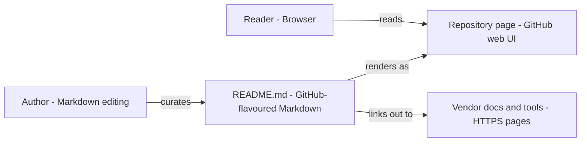

# Data Engineering Resources - Architecture and design rationale

*Last updated: 2026-11-07 · commit 8a9bd36d4*

## 1. Purpose and scope

A single curated README of resources for data engineering: Snowflake, dbt, data quality tools, Python libraries and the
modern data stack, plus three featured portfolio projects. It is a reading list for learners, and a record of what the
owner found useful. It is not an exhaustive directory, not automatically checked for dead links, and not a product.

## 2. How this project was built

This project was built with Claude Code (Anthropic's AI coding assistant) in a complementary role. Elliott Fairhall is
the author and owner: the list is selected, used and maintained by him for learning and development. The repository is
content only, with no code. The git history for this folder is short (two commits) and does not record how the text was
drafted, so this document makes no claim about which passages were AI-assisted.

## 3. Architecture at a glance

- The author edits one file; GitHub renders it; readers follow links out to vendor documentation.

There is one file. GitHub renders it as the project home page, so the repository is the site. All value is in the
selection and the short commentary around each link.

## 4. Components

| Component                 | Responsibility                                                      | Key files                 | Depends on               |
| ------------------------- | ------------------------------------------------------------------- | ------------------------- | ------------------------ |
| Featured projects         | Link to three end-to-end Snowflake portfolio projects               | `README.md` (top section) | The project repositories |
| Snowflake section         | Docs, training, community, tutorials, channels                      | `README.md`               | Vendor sites             |
| dbt, data quality, Python | Short guides, with "when to use which" comparisons                  | `README.md`               | Vendor sites             |
| Modern data stack         | Integration and orchestration tools, and a closing pipeline summary | `README.md`               | Vendor sites             |
| Table of contents         | Manual anchor list                                                  | `README.md`               | Heading text             |

The curation model: each tool gets a one-line purpose and a link, and the comparison sections (data quality tools,
Pandas versus Polars, Airbyte versus Fivetran) give a decision rule rather than a feature list. The closing section ties
the tools into one pipeline (ingestion, transformation, orchestration, quality, analysis).

## 5. Data and control flow

There is no runtime. Maintenance is manual: the owner edits the README, commits, and the page updates. The monorepo
mirrors the folder to the standalone repository (see `docs/automation.md` in the parent knowledge-base repository).
Failure shows as a stale or broken link, found only by a reader or a manual check.

## 6. Design rationale

### A README is the whole site

- **Why:** for a list of several dozen links maintained by one person, GitHub already provides rendering, search,
  history, and a stable URL. There is nothing to build, host or secure.
- **Gave up:** no search box, tagging, filtering, scheduled link checks, or analytics. Layout is whatever GitHub
  Markdown allows.
- **Alternative not taken:** a page on the Data Flakes Astro site, or a generated site. Better presentation, but it adds
  a build and a hosting dependency to a list that changes slowly.
- **Evidence:** inferred from the repository shape (one file). Folder history shows only a rename and a formatting sync.

### Curated and opinionated, not exhaustive

- **Why:** a learner is helped more by a few trusted starting points per topic and a "when to use which" rule than by
  fifty links. The sections reflect the owner's working stack (Snowflake, dbt, Python).
- **Gave up:** coverage. Tools outside that stack are missing, and the list reflects one person's view.
- **Alternative not taken:** an "awesome list" format with many entries per category.
- **Evidence:** inferred from the content; the "Best Practices (2025)" heading shows the list is dated by hand.

### Featured projects first

- **Why:** the repository doubles as a portfolio signpost, so working examples sit above the reference lists.
- **Gave up:** a reader who only wants references scrolls past them.
- **Alternative not taken:** a separate portfolio page; that role is covered by the Project-Repo project.
- **Evidence:** inferred from the layout.

### Manual table of contents and plain Markdown

- **Why:** it works in every Markdown viewer with no tooling.
- **Gave up:** anchors can drift when a heading changes; the headings include emoji, which makes anchors harder to type.
- **Alternative not taken:** a generated table of contents.
- **Evidence:** inferred from the file.

## 7. Quality and testing

None automated. No link checker or Markdown lint configuration is in this folder; the parent repository runs Markdown
linting in its pre-commit hooks (TODO: verify that it applies to this path). Accuracy depends on manual review.

## 8. Constraints, limitations and known gaps

- Links and "2025" guidance will age; there is no scheduled review.
- The header image is hot-linked from a third-party image host, so it can disappear or change. TODO: verify and replace
  with a stored image.
- The disclaimer at the foot refers to "this website", which is wording carried over from the Data Flakes site.
- Featured project links point to repositories that this document has not verified still exist.

## 9. Running and extending

Edit `README.md` and preview it in any Markdown viewer. Add entries in the existing shape (name, one-line purpose,
link), update the table of contents, and prefer official documentation links.

## 10. Rationale (confirmed by the owner)

Confirmed by Elliott Fairhall on 2026-11-07. This reasoning was first reconstructed from the code and commit history;
the owner has since agreed it is correct, so it is now the stated rationale rather than an inference.

- A single README was chosen for low maintenance rather than as a first step towards a site.
- The list is deliberately narrow to the owner's own stack.
- Featured projects sit first to double as a portfolio signpost.
- The hot-linked header image was a convenience, not a decision.
